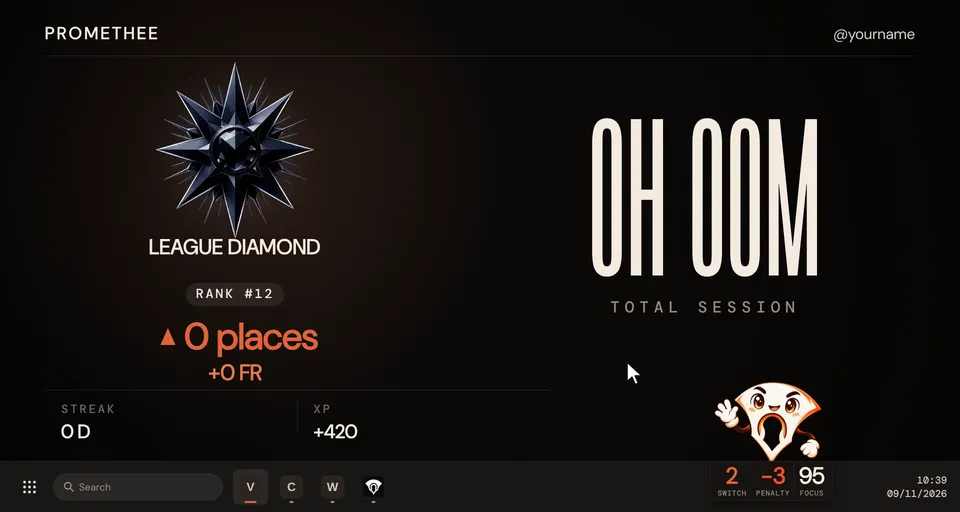
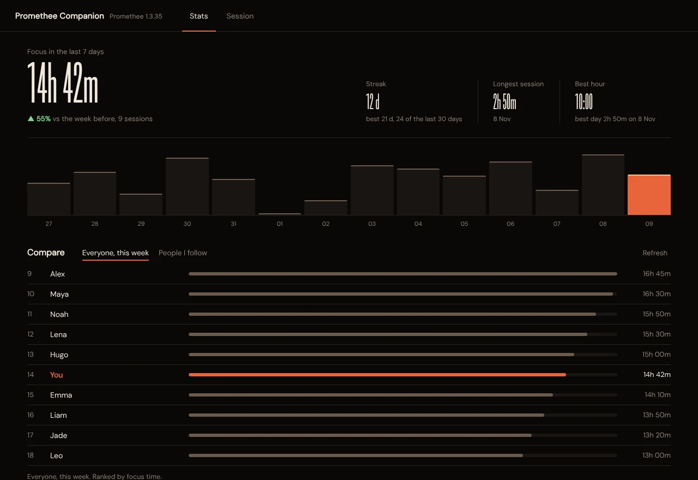
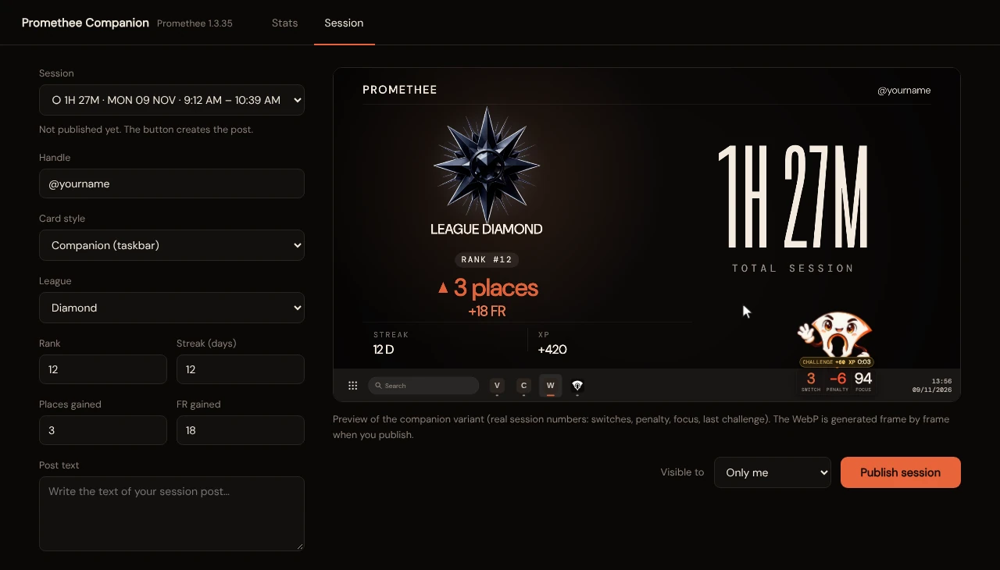

# Promethee Companion

> **Windows and macOS.** Windows is the main platform. macOS support is newer, see
> [macOS](#macos) below. The platform specific parts are listed in
> [docs/HOW_IT_WORKS.md](docs/HOW_IT_WORKS.md).

A small desktop companion for the Promethee focus app. It sits above your
Windows taskbar (on macOS: hidden in the notch, popping out when you switch away) and follows your
session live, and it
includes **Card Studio**, where you can look at your stats and publish the end-of-session card to your
Promethee feed.

This is an unofficial project, not affiliated with Promethee. It relies on the app's own local data and
network calls, so a Promethee update can occasionally break it.

## Preview

The end-of-session card, animated (sample data):



Card Studio, with your stats and a comparison with other people (sample data):



And the Session tab, to publish or edit a card:



## Requirements

- Windows, or macOS (tested on macOS 27, Apple silicon)
- [Node.js](https://nodejs.org) 22.12 or newer (older versions cannot install the current Electron)
- The Promethee desktop app, installed, signed in, and opened at least once

## Install

```
git clone https://github.com/creatorsarea/promethee-companion.git
cd promethee-companion
npm install
npm start
```

The companion appears above your taskbar and an icon is added to the notification area. Click the
companion to open Card Studio. On first launch it registers itself to start with Windows; you can turn
that off from the tray icon menu.

## macOS

- **In the notch**: the companion hides in the MacBook notch while you focus. When you switch away
  from your app, it springs out of the notch, angry, with the "Back to <app>" countdown, and goes
  back up when you return or when the switch is counted. It also peeks out briefly when a session
  starts or ends, and comes out when you hover the notch (click it to open Card Studio). Without a
  notch it does the same from the middle of the menu bar's bottom edge. To keep it always visible in
  the bottom-right corner instead, use **Position** in the menu bar icon's menu.
- **Menu bar icon**: there is no Dock icon while only the companion runs. Click the menu bar icon for
  the menu. Card Studio gets a Dock icon while it is open.
- **Keychain prompt**: the first time the companion reads your Promethee login, macOS asks whether
  `security` may use the "Promethee Safe Storage" item in your keychain. Click **Allow** (asked again
  at each launch) or **Always Allow** (stops asking, and lets the `security` tool read this item
  without asking from then on). If you deny it, the live companion and the local stats still work,
  but the comparison, publishing and follow features do not.
- **No other permission**: the foreground app is read with `NSWorkspace` through `osascript`, which
  needs no Accessibility or Screen Recording access.
- **Open at login**: off by default. Turn it on from the menu bar icon menu; it adds a LaunchAgent
  (`~/Library/LaunchAgents/fr.creatorsarea.promethee-companion.plist`), and macOS shows a
  "Background item added" notification.
- **Promethee**: installed in `/Applications` or `~/Applications`.

## Update

```
git pull
npm install
```

Then quit the companion from the tray icon menu (menu bar icon on macOS) and start it again with `npm start`.

## Privacy

Everything runs on your computer. Your Promethee login token is read locally from the Promethee app's
own session file. It is only sent to Promethee's servers, never anywhere else, and it is never logged.
The stats and ranking views only read data. Something is written to your account only when you press
"Publish session" or "Follow".

The only other network call is a public, anonymous request to GitHub to check whether a newer release
exists (nothing about you is sent). If there is one, a small notice appears in the tray menu and in the
Card Studio header.

## Troubleshooting

| Message | What to do |
|---|---|
| `Token expired` or `token unavailable` | Open the Promethee app so it refreshes your session, then restart the companion. |
| `Promethee public key not found` | Update the Promethee app to its latest version, then restart the companion. |
| `No app-x.y.z folder` | The Promethee app is not installed for your user. Install it and open it once. |
| `Promethee.app not found` (macOS) | Install Promethee in `/Applications` or `~/Applications` and open it once. |
| `Promethee key not readable from the Keychain` (macOS) | You denied the Keychain prompt. Restart the companion and click Allow. |
| The companion is off screen or in the wrong place | Right-click the tray icon and choose "Reset position (bottom right)". |

## Contributing

Issues and pull requests are welcome. See
[docs/HOW_IT_WORKS.md](docs/HOW_IT_WORKS.md) for how the numbers are computed, which Promethee routes are
used, and the layout of the code.

## License

Copyright (C) 2026 Zaros. Released under the [GNU Affero General Public License v3.0](LICENSE). You can use,
study, modify and share this project, but if you distribute a modified version you must publish its source under
the same license. The license covers this project's code and the companion mascot artwork in `companion/assets`,
which is original work by Zaros. The Promethee name, logo, fonts, league images and app icons belong to their
owners and are read from your own Promethee installation, not shipped here.
